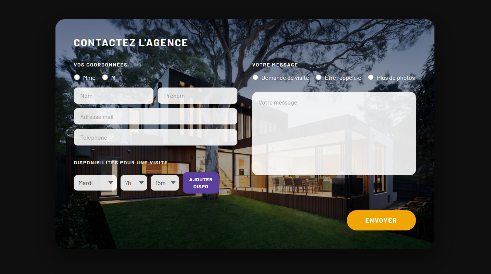

# Agence Immo — Contact Form


> Integration of a contact form mockup for a real estate agency, with data saved to a database.

---

## About Me

- **Name**: CHETLOUL Nada Cherine
- **Level of study**: 2nd-year Bachelor's in Computer Science
- **Desired internship duration**: 2 months — starting May 1st
- **Profiles**:
  - GitHub: [https://github.com/nada-chetloul](https://github.com/nada-chetloul)
  - LinkedIn: [www.linkedin.com/in/nada-cherine-chetloul-32a2b02a6](www.linkedin.com/in/nada-cherine-chetloul-32a2b02a6)

---

## Screenshots

> Main form page:




---

## Tech Stack & Choices

| Tool | Version | Reason for choice |
|---|---|---|
| **Next.js** | 14 (App Router) | Full-stack React framework that lets you co-locate API routes and UI in a single project, ideal for this kind of form with persistence. |
| **TypeScript** | 5 | Static typing that prevents compile-time errors, essential for the robustness of form data and API calls. |
| **Prisma** | 5 | Modern ORM with auto-completion, migrations, and a very readable declarative schema — reduces the risk of SQL errors and simplifies schema changes. |
| **SQLite** | 3 | Embedded database, zero configuration, ideal for a demo project. Easily replaced by PostgreSQL in production. |
| **CSS Modules** | — | CSS scoping native to Next.js, avoids class conflicts without any extra dependency. |
| **Google Fonts** (Barlow + Cormorant) | — | Barlow for form readability, Cormorant for a luxurious tone consistent with high-end real estate. |

---

## Running the Project

### Prerequisites

- Node.js >= 18
- npm or yarn

### Installation

```bash
# 1. Clone the repository
git clone https://github.com/votre-profil/agence-immo.git
cd agence-immo

# 2. Install dependencies
npm install

# 3. Configure environment variables
cp .env.example .env
# DATABASE_URL="file:./dev.db" is already configured for SQLite

# 4. Create the database and apply the schema
npx prisma db push

# 5. Start the development server
npm run dev
```

Open [http://localhost:3000](http://localhost:3000)

### Useful Commands

```bash
npm run dev        # Development server
npm run build      # Production build
npm run start      # Run the production build
npx prisma studio  # Visual interface to explore the database
```

### Viewing Submitted Data (Prisma Studio)

Form data is saved in a local SQLite database. To view it:

1. Keep `npm run dev` running in a terminal
2. Open a **new terminal** in the same folder
3. Run:

```bash
npx prisma studio
```

4. Open [http://localhost:5555](http://localhost:5555) in your browser
5. Click on the **Contact** table to see all submissions

### Environment Variables

Create a `.env` file at the root:

```env
DATABASE_URL="file:./dev.db"
```

---

## Project Structure

```
agence-immo/
├── src/
│   ├── app/
│   │   ├── api/
│   │   │   └── contact/
│   │   │       └── route.ts      # POST + GET contacts API
│   │   ├── globals.css
│   │   ├── layout.tsx
│   │   └── page.tsx
│   ├── components/
│   │   ├── ContactForm.tsx       # Main form component
│   │   └── ContactForm.module.css
│   └── lib/
│       └── prisma.ts             # Prisma Client singleton
├── prisma/
│   └── schema.prisma             # Database schema
├── .env
└── package.json
```

---

## API

### `POST /api/contact`

Saves a form submission.

**JSON body:**
```json
{
  "civilite": "Mme",
  "nom": "Dupont",
  "prenom": "Marie",
  "email": "marie@example.com",
  "telephone": "0612345678",
  "typeMessage": "visite",
  "message": "Je souhaite visiter le bien...",
  "disponibilites": [
    { "jour": "Lundi", "heure": 9, "minute": 30 }
  ]
}
```

**201 response:**
```json
{ "success": true, "id": 1 }
```

### `GET /api/contact`

Returns all saved contacts (descending order).

---

## Questions

**Did you find the exercise easy or difficult? What gave you trouble?**

The exercise was of intermediate difficulty. The trickiest part was faithfully reproducing the mockup while making it functional: handling availabilities (adding/removing time slots as tags) and precisely aligning the two columns with the background image. Integrating Prisma with the Next.js App Router (Server vs Client Components) also required clearly understanding the boundaries.

**Did you learn any new tools to complete the exercise? If so, which ones?**

I deepened my knowledge of the **Next.js App Router** (notably Route Handlers for the API) and **Prisma** with SQLite. Using **CSS Modules** with CSS variables to reproduce a mockup accurately also helped me refine my integration method.

**What place does web development have in your curriculum?**

Web development has a central place in my studies. [Fill in with your situation — e.g.: "I have taken 4 front-end and back-end development modules, with projects in React, Node.js, and relational databases."]

**Did you use an LLM? If so, how do you integrate LLMs at each step of your workflow?**

Yes, I used Claude (Anthropic) as an assistant. My workflow:
1. **Analysis** — I read the exercise on my own and identify the key technical points
2. **Architecture** — I decide the project structure (App Router, Prisma, CSS Modules) autonomously
3. **Generation** — I use the LLM to speed up writing boilerplate code (Prisma schema, TypeScript types) and to get unblocked on specific problems
4. **Review** — I read and understand all generated code before validating it, and adapt it if needed
5. **Documentation** — I use the LLM to structure the README, making sure all required sections are covered

The goal is to keep technical control while gaining execution speed.
